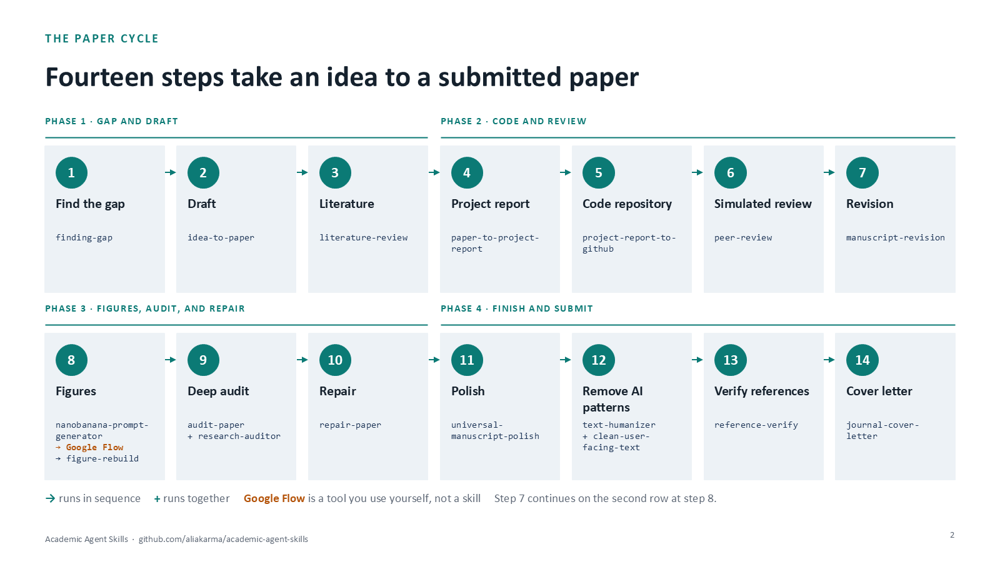
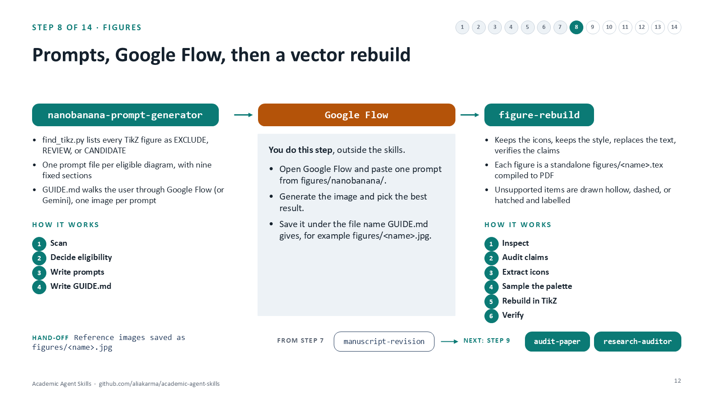
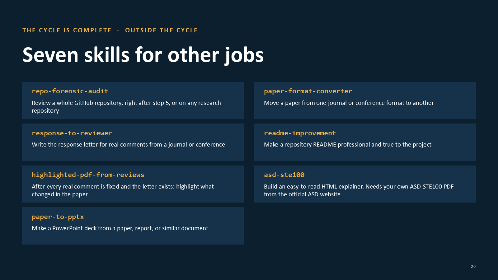
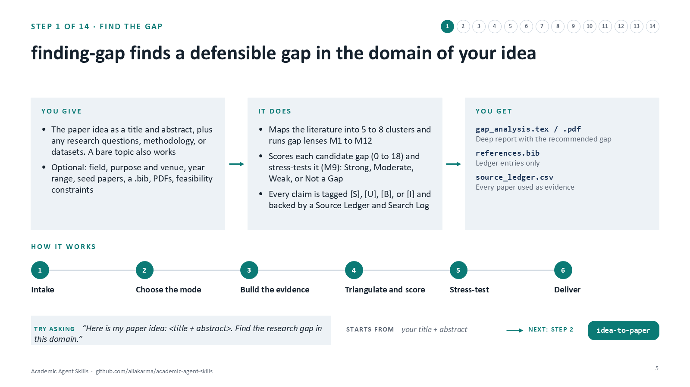

<h1 align="center">Academic Agent Skills</h1>

<p align="center">
  Step-by-step research skills for AI coding assistants.<br>
  From a title and abstract to a submitted paper, with every step checked.
</p>

<p align="center">
  <a href="https://github.com/aliakarma/academic-agent-skills/actions/workflows/validate.yml"></a>
  <a href="https://agentskills.io/specification"></a>
  <a href="LICENSE"></a>
</p>

<p align="center">
  
</p>

## What is this?

AI assistants such as Claude Code, Codex, Antigravity, and Cursor can read and edit the files on your computer. A
**skill** is a folder of written instructions, plus small helper scripts, that tells the assistant exactly how to do
one job. When your request matches a skill, the assistant loads it and follows its steps.

This repository holds **25 skills** for research work: finding a research gap, writing the paper, checking every
reference, answering reviewers, making figures and slides, and more. They are written for researchers, students,
and research engineers who write in LaTeX or Word.

Three promises hold for every skill:

| | Promise | What it means for you |
|---|---|---|
| 🔍 | **Honest output** | No made-up citations, data, results, or test outcomes. Each skill tells you what it could not check, and numbers you have not measured yet stay marked as targets. |
| ✅ | **Checked work** | Wherever a result can be checked by a program, a bundled script checks it before the assistant reports back. |
| 📦 | **One copy for every assistant** | Each skill lives once in [`skills/`](skills/), and the same files work for every installer and assistant. |

## Contents

- [The paper cycle: 14 steps from idea to submission](#the-paper-cycle-14-steps-from-idea-to-submission)
- [Seven skills for other jobs](#seven-skills-for-other-jobs)
- [How to read a skill](#how-to-read-a-skill)
- [Quick start](#quick-start)
- [Example requests](#example-requests)
- [Full skills catalog](#full-skills-catalog)
- [Things you supply yourself](#things-you-supply-yourself)
- [Words used in this README](#words-used-in-this-readme)
- [Repository layout](#repository-layout)
- [Updating and uninstalling](#updating-and-uninstalling)
- [Contributing](#contributing)
- [Security](#security)
- [License](#license)
- [Acknowledgments](#acknowledgments)

## The paper cycle: 14 steps from idea to submission

You bring an idea as a **title and abstract**. You can add research questions, methods, datasets, or results if you
have them. The skills then take the idea to a paper that is ready to submit, in four phases:

| Phase | Steps | What happens |
|---|---|---|
| 1️⃣ **Gap and draft** | 1 to 3 | Find a real gap, write the first draft inside it, and cite checked literature |
| 2️⃣ **Code and review** | 4 to 7 | Turn the paper into tested code, then fix what simulated reviewers find |
| 3️⃣ **Figures, audit, and repair** | 8 to 10 | Make the final figures, audit the paper twice, and repair every finding |
| 4️⃣ **Finish and submit** | 11 to 14 | Polish the language, check every reference, and write the cover letter |

Each step, what you give it, and what you get back:

| Step | Skill | You give | You get |
|:---:|---|---|---|
| 1 | [`finding-gap`](skills/finding-gap/SKILL.md) | Your title and abstract, plus any research questions, methods, or datasets | A research gap that holds up against the published work, with research questions |
| 2 | [`idea-to-paper`](skills/idea-to-paper/SKILL.md) | Your idea and the gap from step 1 | A complete first draft: LaTeX paper, reference list, PDF, and a report of what still needs real data |
| 3 | [`literature-review`](skills/literature-review/SKILL.md) | The draft | A review of the related work, every source checked. Ask it to add the citations to the paper. |
| 4 | [`paper-to-project-report`](skills/paper-to-project-report/SKILL.md) | The paper | `PROJECT_REPORT.md`, a plan for the code the paper describes |
| 5 | [`project-report-to-github`](skills/project-report-to-github/SKILL.md) | The plan and the paper | A working code repository with tests |
| 6 | [`peer-review`](skills/peer-review/SKILL.md) | The paper and its code | Three simulated reviewer reports and a list of what to fix |
| 7 | [`manuscript-revision`](skills/manuscript-revision/SKILL.md) | The paper and the reviews | A revised paper with every comment handled |
| 8 | [`nanobanana-prompt-generator`](skills/nanobanana-prompt-generator/SKILL.md) → Google Flow → [`figure-rebuild`](skills/figure-rebuild/SKILL.md) | The paper's diagrams | Final figures with selectable text, plus an editable PowerPoint copy of each |
| 9 | [`audit-paper`](skills/audit-paper/SKILL.md) + [`research-auditor`](skills/research-auditor/SKILL.md) | The paper and its project folder | Two reports: writing problems (`audit.md`) and research problems (`MASTER_PAPER_ASSESSMENT.md`) |
| 10 | [`repair-paper`](skills/repair-paper/SKILL.md) | Both reports from step 9 | A repaired paper and a record of how each problem was handled |
| 11 | [`universal-manuscript-polish`](skills/universal-manuscript-polish/SKILL.md) | The repaired paper | Polished language. The science stays exactly as it was. |
| 12 | [`text-humanizer`](skills/text-humanizer/SKILL.md) + [`clean-user-facing-text`](skills/clean-user-facing-text/SKILL.md) | The polished paper | Clear, natural prose: vague or inflated wording fixed and stray invisible characters removed |
| 13 | [`reference-verify`](skills/reference-verify/SKILL.md) | The final reference list (`.bib`) | Every reference checked one by one against its publisher or registry record |
| 14 | [`journal-cover-letter`](skills/journal-cover-letter/SKILL.md) | The final paper and the journal's name | A one-page cover letter that follows the journal's rules |

`→` means the skills run one after the other. `+` means they run together.

> [!TIP]
> You do not have to start at step 1. With a finished draft, start at step 6 or step 9. With only a reference list
> to check, go straight to step 13. The [`research-workflow-map`](skills/research-workflow-map/SKILL.md) skill knows
> the whole order and tells the assistant which step comes next.

### Step 8 uses Google Flow

Step 8 is the one place where you work outside the assistant. `nanobanana-prompt-generator` writes one prompt for
each diagram in your paper. You paste each prompt into Google Flow (Google's image tool), save the image under the
file name the skill gives you, and `figure-rebuild` redraws it as a clean figure with real, selectable text.

<p align="center">
  
</p>

## Seven skills for other jobs

These skills sit outside the paper cycle. Use them whenever you need them.

<p align="center">
  
</p>

| Skill | Use it when you want to |
|---|---|
| [`repo-forensic-audit`](skills/repo-forensic-audit/SKILL.md) | Review a whole GitHub repository, right after step 5 or on any research code |
| [`response-to-reviewer`](skills/response-to-reviewer/SKILL.md) | Write the response letter for real comments from a journal or conference |
| [`highlighted-pdf-from-reviews`](skills/highlighted-pdf-from-reviews/SKILL.md) | Highlight what changed in the paper, once every comment is fixed and the response letter is written |
| [`paper-to-pptx`](skills/paper-to-pptx/SKILL.md) | Make a PowerPoint talk from a paper |
| [`paper-format-converter`](skills/paper-format-converter/SKILL.md) | Move a paper from one journal's or conference's format to another |
| [`readme-improvement`](skills/readme-improvement/SKILL.md) | Make a repository's README clear and true to the project |
| [`asd-ste100`](skills/asd-ste100/SKILL.md) | Build an easy-to-read web page that explains a paper or project in Simplified Technical English |

## How to read a skill

Every skill follows the same simple shape: **you give** something, **it does** a fixed set of steps, and **you get**
named files back. Each skill also says which skill comes before it and which comes next.

<p align="center">
  
</p>

To see exactly what a skill does, open its `SKILL.md` file. It is plain text, written for both people and assistants.

## Quick start

### 1. Install

Pick one of the three ways below. You only do this once.

**Option A. Vercel Skills CLI** (Claude Code, Codex, Antigravity, Cursor, and others). It needs
[Node.js](https://nodejs.org/). Preview what the repository offers, then install:

```bash
npx skills add aliakarma/academic-agent-skills --list
npx skills add aliakarma/academic-agent-skills --skill '*' --agent claude-code --global --yes
```

Change `--agent` to `codex`, `antigravity`, or `cursor`, or repeat it to target several assistants. Leave out
`--global` to install into the current project only. To install selected skills only:

```bash
npx skills add aliakarma/academic-agent-skills --skill literature-review --skill reference-verify --agent codex --global --yes
```

For Antigravity and Cursor, a global install writes the skills only to `~/.agents/skills/`. Read
[docs/INSTALLATION.md](docs/INSTALLATION.md#antigravity-and-cursor-global-installs) before you rely on it.

**Option B. Claude Code plugin**

```bash
claude plugin marketplace add aliakarma/academic-agent-skills
claude plugin install academic-agent-skills@academic-agent-skills --scope user
```

Plugin skills get a prefix, for example `/academic-agent-skills:reference-verify`.

**Option C. Copy by hand.** Copy a skill folder from `skills/` into your assistant's skills folder, for example
`~/.claude/skills/reference-verify/` for Claude Code or `~/.agents/skills/reference-verify/` for Codex. Copy the
whole folder, because skills use their own `scripts/`, `references/`, and `templates/` folders.

[docs/INSTALLATION.md](docs/INSTALLATION.md) covers every method, what you need first, the folder each assistant
uses, and troubleshooting. Before you rely on a skill outside Claude Code, check
[docs/PLATFORM_COMPATIBILITY.md](docs/PLATFORM_COMPATIBILITY.md).

### 2. Ask in plain words

Open your assistant in your project folder and describe what you want. The matching skill starts on its own. To
begin the paper cycle:

```text
Here is my paper idea: <title + abstract>. Find the research gap in this domain.
```

When step 1 finishes, the skill names the next step. You can also call any skill by name, for example
`/finding-gap` in Claude Code.

## Example requests

| You ask | Skill that runs | What you get |
|---|---|---|
| "Here is my title and abstract, write the paper" | `research-workflow-map`, then `finding-gap` | The paper cycle from step 1, one skill at a time |
| "The verifier flagged this reference as DOI not found" plus a BibTeX entry | `reference-verify` | A corrected, paste-ready BibTeX entry, checked against the DOI registry and the publisher page |
| "Check every reference in references.bib" | `reference-verify` | A field-by-field report on the whole file (wrong, disputed, retracted, duplicate, and unfound entries), then a verified entry for each flagged one. Also runs as a [Colab notebook](notebook/BibTeX_DOI_Verifier.ipynb) |
| "Do a literature review for main.tex, then cite the verified works in the paper" | `literature-review` | `literature_review.md` with a search log, checked sources, and tested gaps, then the citations added to the paper |
| "Rebuild this figure as TikZ with selectable text" | `figure-rebuild` | A vector figure for the paper and an editable one-slide PowerPoint copy |
| "Draft the response to reviewers" with the reviews and the revised `.tex` | `response-to-reviewer` | A point-by-point letter whose page, line, and number references are checked by script |
| "Write a cover letter for submitting main.tex to IEEE Access" | `journal-cover-letter` | A one-page `cover_letter.tex` and `cover_letter.pdf` based on the paper and the journal's current author instructions, checked by script |
| `/paper-format-converter IEEE Transactions on Smart Grid` | `paper-format-converter` | A `[Venue] Format` folder with the official template, the converted paper, and a conversion report |

## Full skills catalog

All 25 skills with a one-line description each. The [full catalog](docs/SKILLS_CATALOG.md) groups them by topic and
marks the two that run only when you call them by name.

<details>
<summary><b>Show all 25 skills</b></summary>

<!-- catalog:start -->
| Skill | Description | Category |
|---|---|---|
| [`research-workflow-map`](skills/research-workflow-map/SKILL.md) | Routes work through the 14-step paper cycle, from a title and abstract to the cover letter, and the other-purpose skills: what each skill needs first and which runs next. | Workflow and Routing |
| [`finding-gap`](skills/finding-gap/SKILL.md) | Evidence-grounded research-gap discovery with logged searches and a verified source ledger. Stress-tests a proposed gap and drafts research questions, hypotheses, and methods. | Research Discovery and Literature |
| [`literature-review`](skills/literature-review/SKILL.md) | Read-only, evidence-based review of a manuscript's field written to literature_review.md: logged searches, a verified source ledger, gap validation against counterevidence, and a novelty assessment, checked by a bundled script. Edits the paper only on later request. | Research Discovery and Literature |
| [`idea-to-paper`](skills/idea-to-paper/SKILL.md) | Generates a complete LaTeX paper project (IEEE conference by default) from an idea, abstract, or brief, with TikZ figures, a verified references.bib, and unmeasured results marked as targets. | Manuscript Development |
| [`journal-cover-letter`](skills/journal-cover-letter/SKILL.md) | Writes a one-page submission cover letter for a named journal, grounded in the manuscript and the journal's current author instructions, compiled to LaTeX/PDF and checked by a bundled script. | Manuscript Development |
| [`paper-format-converter`](skills/paper-format-converter/SKILL.md) | Converts a manuscript to a named journal's or conference's current official template and guidelines, with a conversion report and a remaining-issues list. Manual only. | Manuscript Development |
| [`universal-manuscript-polish`](skills/universal-manuscript-polish/SKILL.md) | Staged, verified polishing of a LaTeX or Word manuscript for submission, resubmission, or camera-ready, with scan and edit-verification scripts. | Manuscript Development |
| [`audit-paper`](skills/audit-paper/SKILL.md) | Line-by-line forensic writing audit of a manuscript, written to audit.md without editing the paper, and checked by a bundled script. | Academic Writing Quality |
| [`clean-user-facing-text`](skills/clean-user-facing-text/SKILL.md) | Audits suspicious invisible Unicode and revises reader-facing prose while keeping facts, meaning, voice, code, citations, and quotations unchanged. | Academic Writing Quality |
| [`repair-paper`](skills/repair-paper/SKILL.md) | Revises a manuscript against audit.md and research-auditor's assessment so that every numbered issue and finding is repaired or accounted for. | Academic Writing Quality |
| [`text-humanizer`](skills/text-humanizer/SKILL.md) | Drafts, revises, and critiques academic and professional prose for clarity, specificity, and author voice. Also interprets AI-detection and similarity reports. | Academic Writing Quality |
| [`highlighted-pdf-from-reviews`](skills/highlighted-pdf-from-reviews/SKILL.md) | Builds a highlighted revised-manuscript PDF from a LaTeX paper and its response letter, with each change tagged by reviewer-comment ID and mapped to pages. | Peer Review and Revision |
| [`manuscript-revision`](skills/manuscript-revision/SKILL.md) | Revises a manuscript against every editor and reviewer comment, runs the experiments reviewers request, and writes a matching response letter, with a script that keeps the run going until each comment is addressed or its blocker is stated. | Peer Review and Revision |
| [`peer-review`](skills/peer-review/SKILL.md) | Simulates a three-reviewer Q1 journal peer review with an area-chair meta-review, for whole manuscripts or single sections. | Peer Review and Revision |
| [`response-to-reviewer`](skills/response-to-reviewer/SKILL.md) | Drafts, updates, or verifies a point-by-point response-to-reviewers letter, with scripts that check completeness, page and line references, and numbers. | Peer Review and Revision |
| [`reference-verify`](skills/reference-verify/SKILL.md) | Checks one reference against publisher, DOI, Crossref, arXiv, or issuing-body sources and returns a corrected, paste-ready BibTeX entry. Triages a whole .bib file by script first, with a Colab notebook front end. | Research Quality Assurance |
| [`repo-forensic-audit`](skills/repo-forensic-audit/SKILL.md) | Forensic audit of a research code repository for reproducibility, hard-coded metrics, disconnected evaluation pipelines, and other fabrication fingerprints. | Research Quality Assurance |
| [`research-auditor`](skills/research-auditor/SKILL.md) | Independent pre-submission diagnosis of a research project: its real claims, the research gap checked against the literature, closest prior work, journal fit, and acceptance blockers. | Research Quality Assurance |
| [`asd-ste100`](skills/asd-ste100/SKILL.md) | Builds an interactive offline HTML explainer of a paper, method, or codebase, with visible text written to ASD-STE100 Issue 9 Simplified Technical English rules. Needs your own authorized copy of the specification, which is not included. Manual only. | Figures, Slides and Explainers |
| [`figure-rebuild`](skills/figure-rebuild/SKILL.md) | Rebuilds a raster or AI-generated research figure as LaTeX/TikZ with selectable text and a matched style, plus an editable one-slide PowerPoint twin, and audits the figure's claims against measured results. | Figures, Slides and Explainers |
| [`nanobanana-prompt-generator`](skills/nanobanana-prompt-generator/SKILL.md) | Writes a NanoBanana prompt for every TikZ diagram in a paper, never for results figures, and a step-by-step guide for making reference images in Google Gemini or Flow that figure-rebuild then turns into vector figures. | Figures, Slides and Explainers |
| [`paper-to-pptx`](skills/paper-to-pptx/SKILL.md) | Turns a LaTeX paper into an editable 15-slide PowerPoint talk deck that stays faithful to the paper, with rendered equations and a number-fidelity check. | Figures, Slides and Explainers |
| [`paper-to-project-report`](skills/paper-to-project-report/SKILL.md) | Converts a paper into an implementation-oriented PROJECT_REPORT.md (engineering spec, reproducibility audit, roadmap phases), checked by a bundled script. | Research Engineering and Repositories |
| [`project-report-to-github`](skills/project-report-to-github/SKILL.md) | Builds a runnable, tested, GitHub-ready research code repository from a PROJECT_REPORT.md and the paper's .tex, checked by a bundled script. | Research Engineering and Repositories |
| [`readme-improvement`](skills/readme-improvement/SKILL.md) | Refactors a repository README.md to publication quality without changing the project's technical meaning. | Research Engineering and Repositories |
<!-- catalog:end -->

</details>

## Things you supply yourself

| Skill | What you need | Why |
|---|---|---|
| `asd-ste100` | Your own copy of the ASD-STE100 specification (PDF) | The standard is not included. Download it from the official ASD website, then give it to the assistant or save it in the skill's `references/` folder. [skills/asd-ste100/REFERENCES.md](skills/asd-ste100/REFERENCES.md) explains how. |
| `paper-to-pptx` | Anthropic's `pptx` skill | This repository does not include it |
| `nanobanana-prompt-generator` | Access to Google Flow (or Google Gemini) | You generate the figure images there yourself |

## Words used in this README

| Word | Meaning |
|---|---|
| **Assistant** (or agent) | An AI tool that can read and change files on your computer, such as Claude Code, Codex, Antigravity, or Cursor |
| **Skill** | A folder with a `SKILL.md` instruction file and helper scripts. The assistant follows it when your request matches. |
| **LaTeX** (`.tex`) | A typesetting system many journals use for papers |
| **BibTeX** (`.bib`) | The reference-list file that goes with a LaTeX paper |
| **TikZ** | A way to draw diagrams inside LaTeX, so the text in a figure stays real, selectable text |
| **Terminal** | The window where you type commands such as `npx` or `claude` |

## Repository layout

```text
academic-agent-skills/
├── skills/           one folder per skill: SKILL.md plus its scripts, references, and templates
├── docs/             installation, compatibility, full catalog, architecture, and the images in this README
├── scripts/          repository checks: validate_skills.py and generate_catalog.py
├── tests/            automated tests for the skills and the repository
├── notebook/         a Colab notebook that checks a whole .bib file
├── .claude-plugin/   Claude Code plugin and marketplace files
└── .github/          automated checks that run on GitHub
```

## Updating and uninstalling

Update:

```bash
npx skills check                      # report available updates without installing
npx skills update                     # Vercel Skills CLI installs
claude plugin marketplace update academic-agent-skills
claude plugin update academic-agent-skills@academic-agent-skills
```

Uninstall:

```bash
npx skills remove aliakarma/academic-agent-skills --global --yes   # removes only this collection's skills
claude plugin uninstall academic-agent-skills@academic-agent-skills
claude plugin marketplace remove academic-agent-skills
```

> [!WARNING]
> Do not uninstall with `npx skills remove --skill '*'`. It removes every installed skill, including skills from other
> sources.

## Contributing

New skills, fixes, and reports on how the skills behave in other assistants are welcome. Read
[CONTRIBUTING.md](CONTRIBUTING.md), then run the checks on your computer:

```bash
pip install -r requirements-dev.txt
python scripts/validate_skills.py
python scripts/generate_catalog.py --check
python -m pytest tests
```

[docs/ARCHITECTURE.md](docs/ARCHITECTURE.md) explains how one `skills/` folder serves every way of installing.

## Security

Skills run with the same permissions as the assistant that loads them. Read a skill's `SKILL.md` and its scripts
before you install it. Report security problems, leaked secrets, personal data, or content that may not be shared
through GitHub's private vulnerability reporting, as described in [SECURITY.md](SECURITY.md).

## License

This project is released under the [MIT License](LICENSE). You may use, copy, change, share, and sell it, in open or
closed projects, as long as every copy keeps the copyright notice and the license text.

The license covers this project's own material. Third-party material keeps its own license, and the ASD-STE100
specification is not part of this repository. [docs/LICENSE_AND_ATTRIBUTION.md](docs/LICENSE_AND_ATTRIBUTION.md)
explains what the license covers, how to credit the project, and the third-party material.

## Acknowledgments

- The [Agent Skills specification](https://agentskills.io/specification) defines the skill format used here.
- [Vercel Skills CLI](https://github.com/vercel-labs/skills) installs the skills across assistants.
- [Claude Code plugins](https://code.claude.com/docs/en/plugins) provide the native plugin and marketplace format.
