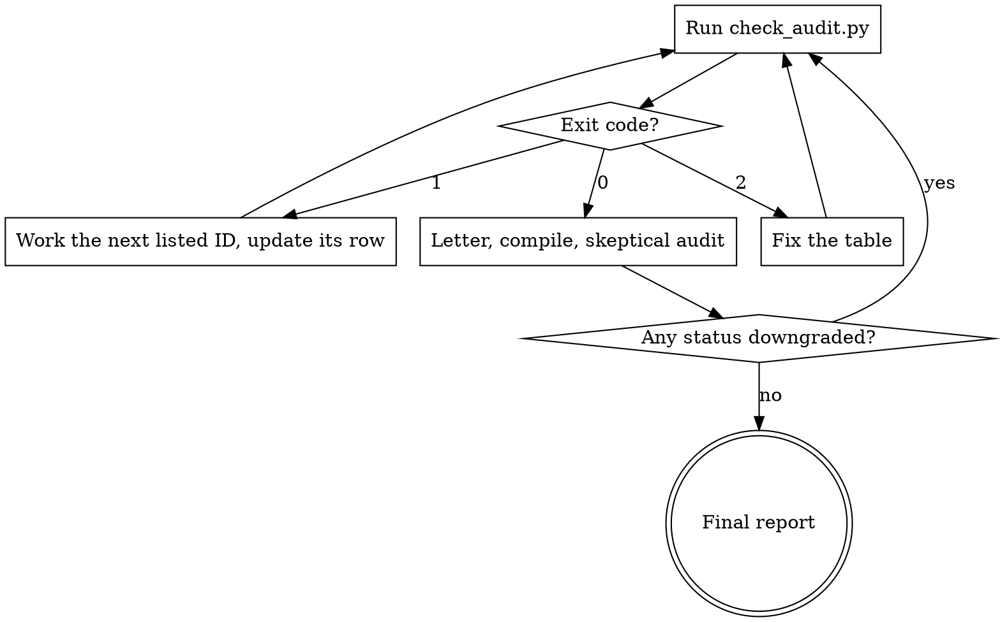

# Manuscript Revision

> **Paths.** `${CLAUDE_SKILL_DIR}` is the folder that holds this SKILL.md. Claude Code fills it in. In other agents, replace it with that folder's path. `${CLAUDE_SKILL_DIR}/../<skill>` is a sibling skill from the same collection, so install that skill too.

## Overview

This skill fixes every single editor and reviewer comment completely, in the actual files: text, equations, figures, tables, bibliography, supplements, code, and experiments. It runs the experiments the reviewers ask for and does whatever is possible to address every comment. It does not stop until every comment is addressed. The only exception is a comment that truly needs something only the authors can supply, and then it says exactly what that is. Nothing is fabricated to get there.

**REQUIRED:** Read `references/requirements.md` in full at the start of every run. It is the author's own specification, word for word: six phases, the research-integrity rules, the definition of done, and the final report. Every rule in it applies. This file adds the author's later instructions: work every comment to completion, run the requested experiments, and do not stop early. Nothing here relaxes an integrity rule in its Section 2.

**Sub-skills** (siblings in this collection, install them together):
- **response-to-reviewer** writes and verifies `response_to_reviewers.tex` (Phases 4 and 5). Use its template and its three checks.
- **reference-verify** checks every new or reviewer-suggested reference before it goes into the `.bib`.
- **universal-manuscript-polish** supplies the house style for every sentence you write. Run its Stage 3 across the whole paper after the revision edits and before you write the letter.
- **text-humanizer** guides the prose decisions.
- Optional: **highlighted-pdf-from-reviews** when the venue wants a marked-up PDF, **figure-rebuild** for redrawn figures, **literature-review** when reviewers ask for broader related work.

## The completion loop



```
python "${CLAUDE_SKILL_DIR}/scripts/check_audit.py" revision_audit.md
```

Exit 1 lists the IDs that still need work. Take the next one, do the work, update its row, and run the check again. Do not stop at exit 1 to summarize, to ask about routine decisions, or because the remaining work is long. When the run nears the context limit, keep `revision_audit.md` current so the next session resumes from the IDs the check lists.

### When BLOCKED is allowed

An ID may be BLOCKED only when all four of these are true:
1. What it needs is not in the project, and no tool here can produce it. Examples: new participant or field data, hardware you do not have, an ethics approval number, an author decision on scope or authorship, a licensed resource, or compute far beyond this machine (state your estimate, such as "about 40 GPU-days").
2. You tried. The row names what you checked and what you ran.
3. All adjacent work is done: the text clarification, the limitation statement, a ready-to-run script for the experiment, and the letter wording.
4. The Blocker cell says exactly what the authors must supply and what you will do with it: `needs: <input>, then <next step>`.

These are not blockers: "it would take a long time" (start it and keep working), "the reviewer is probably wrong" (show the evidence, clarify the text, then mark ADDRESSED), "it is optional" (do it, or give the evidence-based reason not to), and "the change is small" (make it). Revisit every BLOCKED row once more before the final report.

## Experiments the reviewers ask for

Use this for every requested experiment, ablation, baseline, sensitivity or robustness test, statistical test, runtime measurement, or new figure from data:
1. Find the code and data that produced the original result. Read the code. Do not infer its behavior from the prose.
2. Plan the smallest experiment that answers the reviewer's question. Reuse the project's scripts, configs, and seeds.
3. Write all outputs to `revision_experiments/<ID>/`, never over the original inputs or results. Put new code in a script file so it can be rerun.
4. Run it. Start a long run in the background, keep working on other IDs, and check its log early for failures.
5. Record the command, config, seed, environment, run time, and output files in the ID's row.
6. Put the actual numbers into the paper. Regenerate tables and figures from the output files, then update every place that repeats the number (abstract, discussion, conclusion, supplement). Report unfavorable results as they are.
7. If only a reduced run is feasible (fewer seeds, fewer epochs, a data subset), run it and label it as reduced in the manuscript and the letter, saying what was reduced. Keep the full run as BLOCKED only if the reviewer's question still needs it.
8. If it cannot run here, write the ready-to-run script and the exact command, then mark the ID `BLOCKED` with `needs: authors run <command>; outputs to revision_experiments/<ID>/`.

When the authors run an experiment themselves and hand over the output, check that the output files exist, read the numbers from them (never from the message alone), and finish the ID with step 6.

## Phase specifics

Follow Phases 1 to 6 of `references/requirements.md`. These additions apply:

| Phase | Addition |
|---|---|
| 1. Inspect and map | The reviewer file is `peer-review.md` or whatever file the user names. If `revision_audit.md` already exists, back it up, run `check_audit.py`, and resume from the IDs it lists instead of starting over. Write the comment table in the format below |
| 2. Plan | Keep the plan per ID in its own section. The comment table holds status only |
| 3. Revise | Edit the real files. Run experiments by the protocol above. Send new references through reference-verify. Then run universal-manuscript-polish Stage 3 on the whole paper |
| 4. Letter | Follow the response-to-reviewer workflow, writing `response_to_reviewers.tex`. Build its inventory with `check_audit.py revision_audit.md --tsv <scratch>/inventory.tsv`. Answer a BLOCKED ID plainly: what was done, what was not, and why |
| 5. Validate | Compile the manuscript and the letter. Run response-to-reviewer's `check_completeness.py`, `check_locations.py`, and `check_numbers.py` from `${CLAUDE_SKILL_DIR}/../response-to-reviewer/scripts/`. Then run `check_audit.py revision_audit.md --letter response_to_reviewers.tex` |
| 6. Skeptical audit | Reread each comment, its edit, and its response. Downgrade any status the files do not support, then go back into the loop |

### Comment table format

```
| ID | Reviewer | Request | Location | Action and evidence | Status | Blocker |
|---|---|---|---|---|---|---|
| ED-01 | Editor | "Shorten the abstract." | Abstract | Cut from 310 to 240 words | ADDRESSED | |
| R1-01 | Reviewer 1 | "Compare against X." | Sec. 5.2, Table 4 | revision_experiments/R1-01/run.py, seed 0; Table 4 row added | ADDRESSED | |
| R2-03a | Reviewer 2 | "Validate on field data." | Sec. 6.3 | Limitation added; no field data in the project | BLOCKED | needs: field dataset from the authors, then rerun eval.py on it |
```

Use ED-01 for the editor, R1-00 for a reviewer's general assessment, two-digit numbers (R1-01), and a letter suffix for each request split out of a compound comment (R2-03a, R2-03b). Keep one row per ID in this table and no `|` inside a cell. Status is OPEN, IN PROGRESS, ADDRESSED, or BLOCKED.

## Done

Both `check_audit.py --letter` and response-to-reviewer's checks pass, the manuscript and letter compile, and the skeptical audit changed no status. Then give the final report in Section 10 of `references/requirements.md`. Write "ready for resubmission" only when no ID is BLOCKED. Otherwise write "ready except for" and list the BLOCKED IDs with what each one needs.

## Red flags: keep working

- "The remaining comments are minor, so I'll summarize them."
- "This experiment would take too long," with no estimate and no attempt.
- "I'll describe what the experiment would show."
- An ADDRESSED row with an empty evidence cell.
- The letter says "we added", "we ran", or "we verified", and the files do not show it.
- A reduced run presented as the full one.
- Stopping at exit 1 to ask the user about a routine decision.

## Common mistakes

| Mistake | Fix |
|---|---|
| Editing the results text before rerunning the experiment | Run first, then write from the output files |
| Experiment outputs written over the original results | Use `revision_experiments/<ID>/` |
| A number updated in Results but not in the abstract or conclusion | Search the old value across every `.tex` file and the supplement |
| Writing the letter before the edits | Do the edits, then Stage 3, then the letter |
| One row for a comment with three requests | Split it into R1-04a, R1-04b, R1-04c |
| Script path with a space breaks the call | Quote it: `python "${CLAUDE_SKILL_DIR}/scripts/check_audit.py" ...` |
